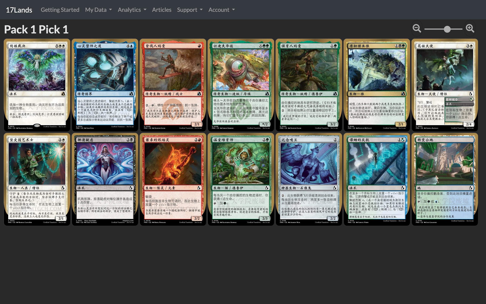
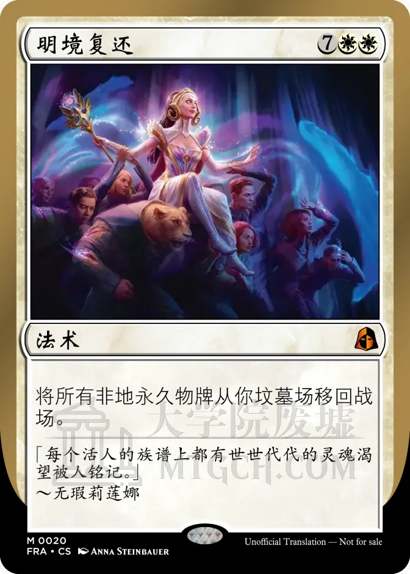

# 17Lands 中文卡图

在17Lands Mock Draft、回放和已选牌区域阅读中文卡图。WXT浏览器扩展通过本机或远程Rust服务读取中文资料，SQLite和浏览器持久缓存减少重复下载；保留原站英文卡牌身份与选牌操作。



Mock Draft实拍（2× DPI，2560×1600），点击图片可查看原尺寸。实际覆盖取决于可用中文资料，来源与权利说明见下文。

<details>
<summary>查看单卡细节</summary>

<a href="docs/images/return-to-the-light-realms-zh.webp"></a>

Return to the Light Realms（明境复还），[mtgch原图](https://images.mtgch.com/zhs/large/front/9/e/9e72f397-2384-40f1-882b-f627664d97df.webp?ts=1788959471)，来源标记为TrentTouch。保留672×941原始文件与水印；页面放大后的清晰度受上游素材限制。

</details>

## 快速开始

自行运行卡库需要Rust 1.88或更新版本；扩展构建需要Bun及Chrome/Edge。已有远程卡库时，只需构建扩展。服务可前台运行于macOS和Linux；macOS另提供用户LaunchAgent自启动。

### 本机卡库

```console
git clone https://github.com/syz51/17lands-zh.git
cd 17lands-zh
cargo build --release --locked
./target/release/mtga-card-cache refresh
./target/release/mtga-card-cache serve
```

首次refresh会下载和校验上游全量简体归档、获取中文图片目录，再发布SQLite快照，网络较慢时需要等待。`serve`启动后也会自动检查到期状态；成功后每24小时再检查，失败退避1小时，继续提供旧快照。前台运行的服务保持终端开启。

另开终端构建扩展：

```console
cd 17lands-zh/extensions/17lands-zh
bun install --frozen-lockfile
bun run build
```

### 使用远程卡库

已有可用的HTTPS卡库时，跳过本机后端的构建与启动步骤。在扩展目录安装依赖后，指定API origin构建；将示例域名替换为你的服务地址，不包含路径：

```console
WXT_API_ORIGIN=https://cards.example.com bun run build
```

构建会同时配置API地址与对应网络权限；重新加载扩展并刷新17Lands页面即可。远程服务部署及配置见[部署说明](docs/deployment.md)。

### 加载扩展

在`chrome://extensions`开启开发者模式，选择“加载已解压的扩展程序”，加载`extensions/17lands-zh/.output/chrome-mv3/`。随后刷新17Lands页面；工具栏弹窗应显示“卡库连接正常”。中文默认开启，可随时切回英文，或点击“重试当前页面”。缺图而有译文时，页面右下角提供“查看中文牌文”；缓存数量与最近数据来源在折叠的“诊断信息”中，表示浏览器累计记录，不是当前页面汉化进度。无需17Lands token、Arena日志或账号配置。

## 本机后台服务

macOS可先停止前台serve，再执行：

```console
./target/release/mtga-card-cache install --dry-run
./target/release/mtga-card-cache install
./target/release/mtga-card-cache status
```

安装会复制稳定二进制并注册用户LaunchAgent，登录后自动运行。更新代码并重新release构建后，再次install更新后台二进制；uninstall停止自启动但保留数据。

默认数据位置：macOS为`~/Library/Application Support/17lands-zh/`；Linux为`$XDG_DATA_HOME/17lands-zh/`或`~/.local/share/17lands-zh/`。`--db <路径>`可覆盖数据库位置。手工`refresh --force`前先停止已运行服务，唯一写入锁会拒绝两个同时运行的writer。

## Docker部署

提供多阶段`Dockerfile`及供Dokploy使用的`compose.yaml`，SQLite资料使用独立命名卷、单writer、每日检查。远程部署须显式指定监听地址与Host白名单，并通过HTTPS反向代理访问。见[部署与备份说明](docs/deployment.md)。

Docker系统包版本范围允许Debian修订及安全更新，升级发行版或软件包版本系列时须重新审查。

## 三层数据

1. **来源层**：从[magic-cards-zhs](https://github.com/HeliumOctahelide/magic-cards-zhs)获取已发布简体归档并验证SHA256，结合[mtgch API v2](https://mtgch.com/api/v2/docs)明确提供的中文图片目录。所有关联使用印刷UUID、Oracle和卡面身份。
2. **卡库服务层**：精简Axum/Hyper/Tokio，SQLite WAL单写多读；使用磁盘scratch库准备完整数据后原子发布，HTTP读取不访问上游。默认监听`http://127.0.0.1:17317`，支持显式配置远程部署，只提供只读API及ETag。
3. **扩展缓存层**：MV3后台批量查询；IndexedDB最多2000项，CacheStorage最多160张/64 MiB。图片经原生解码后才持久化；服务离线时可继续用已有缓存，缺图而有中文字时提供中文阅读面板。

| API | 用途 |
| --- | --- |
| `/healthz` | 服务与SQLite基本健康状态 |
| `/v1/status` | ready、revision、记录数量与刷新日程 |
| `/v1/cards/{printing_id}?lang=zhs` | 单卡中文资料 |
| `/v1/cards?ids=<UUID,...>&lang=zhs` | 最多100卡的批量查询 |

数据schema、并发边界与更新流程见[架构说明](docs/architecture.md)，接口细节见[服务README](crates/card-cache/README.md)，扩展行为见[扩展README](extensions/17lands-zh/README.md)。

## 覆盖与隐私

- 当前导入来源可用的简体资料，不能保证每张牌、每个卡面或完整繁体都有译文。`zht`接口支持不代表全量繁体数据已提供。
- 精确中文图缺失时，可用同Oracle/同卡面的其他中文印刷；插画可能变化，原始请求ID不变。没有中文图或文字时保留英文。
- 服务默认只监听loopback，容器或远程模式需显式配置；不开放网络写接口。扩展只在17Lands运行，不读取Arena日志、token或账号资料，不上传个人选牌历史。
- 上游会收到服务的公开资料请求；图源会收到所加载图片的公开卡牌ID。图片按需下载，不附带全库图片。
- Firefox MV3可构建，但实际运行尚未验收；Safari未提供包装。

## 参与开发

开发环境、检查命令、PR流程及CI漏洞扫描见[贡献说明](CONTRIBUTING.md)，仓库开发约定见[AGENTS.md](AGENTS.md)。商店构建与资料见[发布说明](docs/publishing.md)，数据处理见[隐私政策](docs/privacy.md)。安全问题请按[SECURITY.md](SECURITY.md)私密报告。

## 许可与第三方权利

本仓库应用代码使用[MIT License](LICENSE)。此许可不覆盖下载的卡牌资料、译文、卡图或依赖包；它们保留各自的许可及权利。

- 中文资料由[大学院废墟 mtgch](https://mtgch.com/)及其推荐的[magic-cards-zhs](https://github.com/HeliumOctahelide/magic-cards-zhs)提供。该资料仓库使用[CC BY-SA 4.0](https://github.com/HeliumOctahelide/magic-cards-zhs/blob/main/LICENSE-CC-BY-SA.txt)；译文可能来自官方文本、MTGso、Forge Data及志愿者。服务保留逐卡来源、来源链接与上游版本。再次分发资料或其改编时，应遵守相应署名及相同方式共享要求。
- 英文卡牌身份来自上游资料中的[Scryfall](https://scryfall.com/)字段。中文图来自`images.mtgch.com`；扩展的图片来源白名单也允许`cards.scryfall.io`。仓库不附带全量卡图或实际中文数据库。
- Magic: The Gathering卡牌名称、规则及图像等相关权利归Wizards of the Coast及相应权利人所有。中文资料许可不等于卡图版权授权。
- [17Lands](https://www.17lands.com/)、mtgch、Scryfall与本项目无隶属或背书关系。本项目只处理浏览器中的中文展示，不包含17Lands客户端代码。

## 开源致谢

感谢数据与卡图提供者，以及以下开源项目的维护者和贡献者：

| 用途 | 项目 |
| --- | --- |
| HTTP服务与并发 | [Axum](https://github.com/tokio-rs/axum)、[Hyper](https://github.com/hyperium/hyper)、[hyper-util](https://github.com/hyperium/hyper-util)、[Tokio](https://github.com/tokio-rs/tokio) |
| SQLite访问与文件锁 | [rusqlite](https://github.com/rusqlite/rusqlite)、[SQLite](https://sqlite.org/)、[fs2](https://github.com/danburkert/fs2-rs) |
| JSON与数据序列化 | [Serde](https://github.com/serde-rs/serde)、[serde_json](https://github.com/serde-rs/json) |
| 命令行与错误处理 | [Clap](https://github.com/clap-rs/clap)、[anyhow](https://github.com/dtolnay/anyhow) |
| HTTP客户端与TLS | [ureq](https://github.com/algesten/ureq)、[Rustls](https://github.com/rustls/rustls) |
| 归档与解压 | [flate2](https://github.com/rust-lang/flate2-rs)、[tar](https://github.com/composefs/tar-rs) |
| 时间、URL与摘要 | [Jiff](https://github.com/BurntSushi/jiff)、[url](https://github.com/servo/rust-url)、[sha2 / RustCrypto](https://github.com/RustCrypto/hashes) |
| 临时文件与系统接口 | [tempfile](https://github.com/Stebalien/tempfile)、[libc](https://github.com/rust-lang/libc) |
| HTTP测试 | [Tower](https://github.com/tower-rs/tower) |
| 扩展构建与类型检查 | [WXT](https://github.com/wxt-dev/wxt)、[TypeScript](https://github.com/microsoft/TypeScript) |
| JavaScript工具链与类型定义 | [Bun](https://github.com/oven-sh/bun)、[@types/bun / DefinitelyTyped](https://github.com/DefinitelyTyped/DefinitelyTyped/tree/master/types/bun) |
| DOM测试 | [Happy DOM](https://github.com/capricorn86/happy-dom) |
| 容器与依赖安全检查 | [Trivy](https://github.com/aquasecurity/trivy)、[setup-trivy](https://github.com/aquasecurity/setup-trivy) |

上表列出直接依赖及相关运行时、测试工具；Rust与扩展依赖版本由[`Cargo.lock`](Cargo.lock)及[`bun.lock`](extensions/17lands-zh/bun.lock)固定，CI工具版本与action提交固定在[工作流](.github/workflows/check.yml)。各项目的许可证以其源仓库及发行包为准；[SQLite的版权说明](https://sqlite.org/copyright.html)单独列出其公有领域声明。
